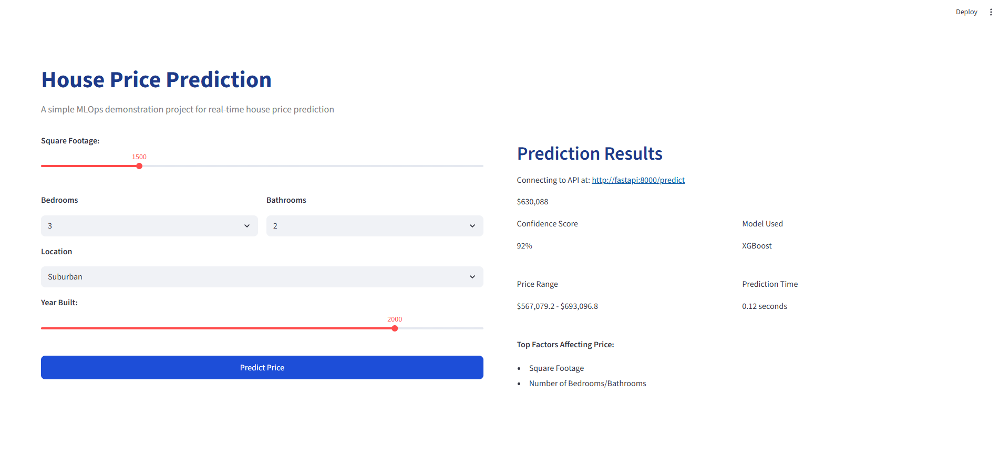

# 🏠 House Price Predictor — End-to-End ML System with Docker Compose

An end-to-end, containerized Machine Learning application that predicts real estate prices based on property features such as square footage, location, year built, and number of rooms. Built to simulate a production-grade ML architecture locally using **MLflow**, **FastAPI**, **Streamlit**, and **Docker Compose** with DNS-based service discovery.

## 📸 Demo

### Streamlit Web UI


## 🏗️ System Architecture

```text
[ Streamlit UI (:8501) ] ──(http://fastapi:8000/predict)──▶ [ FastAPI Service (:8000) ] ──▶ [ XGBoost Model & Preprocessor (.pkl) ]
                                                                       │
                                                                       ▼
                                                            [ MLflow Server (:5555) ]
```

| Service | Purpose | Tech Stack | Port | Containerized |
| :--- | :--- | :--- | :--- | :--- |
| **Training Pipeline** | Data processing, feature engineering & model training | Python (`run_pipeline.sh`) | — | Local script |
| **Experiment Tracker** | Log parameters, metrics, and model artifacts | MLflow (`ghcr.io/mlflow/mlflow:latest`) | `5555` | ✅ |
| **Model API** | Serve real-time predictions via REST endpoints | FastAPI (root `Dockerfile`) | `8000` | ✅ |
| **Frontend UI** | Interactive web interface for price predictions | Streamlit (`streamlit_app/Dockerfile`) | `8501` | ✅ |
| **Orchestration** | Multi-service networking & DNS service discovery | Docker Compose (`compose.yaml`) | — | ✅ |

## 📂 Project Structure

```text
House_Price_Predictor/
├── assets/
│   └── streamlit_ui.png            # Screenshot of the Streamlit frontend UI
├── configs/
│   └── model_config.yaml           # Model and training configuration
├── data/
│   ├── raw/
│   │   └── house_data.csv          # Raw dataset
│   └── processed/
│       ├── cleaned_house_data.csv  # Cleaned dataset
│       └── featured_house_data.csv # Engineered features dataset
├── mlflow/
│   └── docker-compose.yaml         # Standalone MLflow Compose config
├── models/
│   └── trained/
│       ├── house_price_model.pkl   # Serialized trained XGBoost model
│       └── preprocessor.pkl        # Serialized feature preprocessor
├── notebooks/
│   ├── 00_data_engineering.ipynb
│   ├── 01_exploratory_data_analysis.ipynb
│   ├── 02_feature_engineering.ipynb
│   └── 03_experimentation.ipynb
├── src/
│   ├── api/
│   │   ├── main.py                 # FastAPI app & REST endpoints
│   │   ├── inference.py            # Model loading & prediction logic
│   │   ├── schemas.py              # Pydantic request/response schemas
│   │   ├── utils.py                # Helper utilities
│   │   └── requirements.txt
│   ├── data/
│   │   └── run_processing.py       # Data cleaning script
│   ├── features/
│   │   └── engineer.py             # Feature engineering script
│   └── models/
│       └── train_model.py          # Model training & MLflow logging
├── streamlit_app/
│   ├── .streamlit/config.toml      # Custom light blue & white Streamlit theme
│   ├── app.py                      # Streamlit frontend application
│   ├── Dockerfile                  # Streamlit container specification
│   └── requirements.txt
├── compose.yaml                    # Multi-service Docker Compose stack
├── Dockerfile                      # FastAPI container specification
├── requirements.txt                # Root Python dependencies
├── run_pipeline.sh                 # End-to-end training pipeline script
└── LICENSE
```

## 🔌 Model & API Overview

* **Algorithm:** XGBoost Regressor
* **Prediction Endpoint:** `POST /predict`
* **Input Features:** Square Footage, Bedrooms, Bathrooms, Location (`Urban`, `Suburban`, `Rural`), and Year Built
* **Output Returned:** Estimated House Price, Confidence Score, Estimated Price Range, Inference Latency, and Top Factors Affecting Price

## 🚀 Getting Started

### Prerequisites

* [Docker](https://docs.docker.com/get-docker/) and [Docker Compose](https://docs.docker.com/compose/install/) installed
* Python 3.9+ (only if running the training pipeline locally)

### 1. Clone the Repository

```bash
git clone https://github.com/<your-username>/House_Price_Predictor.git
cd House_Price_Predictor
```

### 2. Run the Training Pipeline (Optional)

Pre-trained artifacts (`house_price_model.pkl` and `preprocessor.pkl`) are included in `models/trained/`. To re-run data processing, feature engineering, and model training from scratch:

```bash
bash run_pipeline.sh
```

### 3. Launch the Full Stack with Docker Compose

Build and start the **MLflow**, **FastAPI**, and **Streamlit** containers together:

```bash
docker compose up --build
```

*(To run in detached/background mode, add `-d`: `docker compose up --build -d`)*

## 🌐 Accessing the Services

Once the containers are running, open these URLs in your browser:

* **Streamlit Frontend UI:** <http://localhost:8501>
* **FastAPI Interactive Docs (Swagger):** <http://localhost:8000/docs>
* **MLflow Experiment Tracking UI:** <http://localhost:5555>

> **Internal Networking:** Inside the Docker network, the `streamlit` service communicates with the `fastapi` backend using Docker Compose DNS-based service discovery at `http://fastapi:8000/predict`.

## 🛑 Stopping the Services

```bash
docker compose down
```

## 🛠️ Key Concepts Demonstrated

* **Modular ML Pipeline:** Separation of data cleaning, feature engineering, model training, and inference into maintainable Python scripts.
* **Experiment Tracking:** Automated MLflow server setup for tracking runs, metrics, parameters, and model artifacts.
* **Model Serving:** Decoupled REST API using FastAPI with Pydantic schema validation.
* **Containerized Multi-Service Orchestration:** Independent Dockerfiles orchestrated via `compose.yaml` with `depends_on` startup ordering and internal DNS service discovery.
